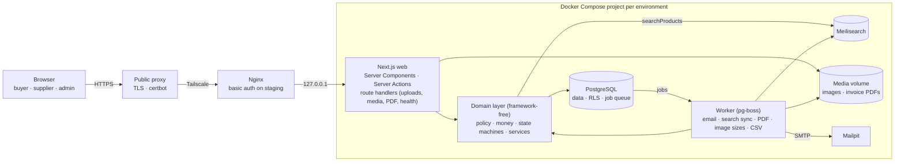
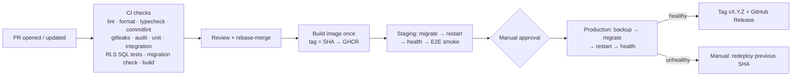

# HoReCa B2B Marketplace

> One place where hotels, restaurants and cafés buy equipment and supplies directly from manufacturers and distributors.
> AI-DEV 2026 practical phase · @BogdanD3 & @MarkoBojovich · DevelopersLab · Coinis

**Status:** 🚧 in development · **Production:** https://horeca.bogdandelic.online · **Staging:** https://staging.horeca.bogdandelic.online (basic auth) · **Repo:** github.com/horeca-ai-dev/horeca-marketplace · **Spec:** [`docs/specification/`](docs/specification/)

## What it does
Suppliers list products manually or via CSV import with a validation report. Buyers — companies, not individuals — search one structured catalogue (category-specific attributes, filters, typo- and diacritics-tolerant search) and check out **once** for products from **several suppliers**. The platform splits the checkout into **per-supplier sub-orders** with independent statuses, computes the **platform commission**, records what each supplier is owed in an **append-only ledger**, and issues **one pro-forma invoice PDF per order** (issued by the platform, which the buyer pays). A platform admin approves suppliers, manages categories and commission, records buyer payments, refunds and supplier payouts, and sees commission owed per supplier.

**No real money flows.** Payments are recorded in an internal ledger and settled by invoice.

### Feature checklist
**MVP**
- [ ] Organizations: buyer, supplier, platform admin · owner/member roles · one user in several organizations (org switcher)
- [ ] Supplier approval (pending → approved / rejected, suspended) · tenant isolation (tested)
- [ ] Category tree with category-specific attributes · product CRUD · images
- [ ] Supplier CSV import with validation report
- [ ] Catalogue behind login · search (Meilisearch) + filters (category, price, supplier, attributes)
- [ ] Multi-supplier cart · checkout · order splitting into sub-orders · sub-order lifecycle
- [ ] Commission · per-supplier ledger and balance · pro-forma invoice PDF · admin overview
- [ ] Recording buyer payments and refunds · recording supplier payouts and adjustments
- [ ] E-mail (Mailpit inbox): order notifications to supplier and buyer · password reset

**Stretch (after the MVP gate — the brief's stretch goals, in this order; see `TASKS.md`)**
- [ ] S1 Volume pricing tiers · buyer-specific prices
- [ ] S3 AI attribute normalisation
- [ ] S4 AI natural-language search
- [ ] S5 Request for quote (RFQ)
- [ ] S6 Card payment via a `PaymentProvider` + mock gateway

*Only if time:* S2 product compare · S7 member invitations by e-mail

## Tech stack
| Layer | Choice | Why |
|---|---|---|
| Architecture | Next.js full-stack monolith (TypeScript), framework-free domain layer | One language and codebase both members can explain; shared types end to end |
| Database | PostgreSQL | Relational integrity for orders and ledger; JSONB attributes; `ltree`; RLS |
| ORM | Drizzle | SQL-shaped, type-safe; clean JSONB, locking and raw SQL |
| Search | Meilisearch behind `searchProducts()` | Typo and diacritics tolerance ("frizider" → "frižider") |
| Auth | Better Auth + organization plugin | Self-hosted; companies with members map onto organizations |
| Validation | Zod | One schema for forms, actions and CSV rows |
| UI → server | Server Components (reads) + Server Actions via next-safe-action (writes) | No API layer to maintain; typed end to end |
| UI | shadcn/ui + Tailwind, TanStack Table, React Hook Form | Owned components, data-dense dashboards, fast forms |
| Jobs | pg-boss (queue inside PostgreSQL) | Jobs are enqueued in the same transaction as the data, so none are lost; no Redis to run |
| Files | Docker volume on the server (a folder locally) behind one storage module + sharp | Product images in 3 WebP sizes served with `srcset` (fast pages); invoice PDFs; no external account; backed up nightly |
| PDF | Playwright HTML → PDF, in the worker | Print-quality invoices from React/Tailwind templates |
| E-mail | React Email templates · SMTP to Mailpit in every environment | The brief needs no real e-mail; demo e-mails are shown in the Mailpit inbox; a real provider = one env variable later |
| Tests | Vitest · Testcontainers · fast-check · Playwright · `psql` | Real Postgres/Meilisearch; RLS SQL tests; property tests for money; E2E on staging |
| Ops | Docker Compose · GitHub Actions · GHCR · Tailscale · Nginx · pino | Build once, promote the same image |
| Versions | Node.js 26 LTS · PostgreSQL 16 · Next.js 16.4 · Meilisearch 1.56 | Exact versions pinned; upgrades ≥ 2 weeks old except security releases |

## Architecture

More diagrams: [`docs/diagrams/`](docs/diagrams/).

## ⚠️ Environment variables: build once, run anywhere

We build ONE Docker image per commit and promote that same image from staging to production. It is never rebuilt.

Next.js replaces every `process.env.NEXT_PUBLIC_*` reference with its literal value AT BUILD TIME. That value is frozen into the JavaScript bundle. Changing `.env.production` on the server does NOT change it.

Consequence: any environment-specific value in a `NEXT_PUBLIC_*` variable (API URL, app URL, Meilisearch key, bucket URL…) would ship with staging's value into production — silently.

### Rules
1. NO environment-specific values in `NEXT_PUBLIC_*`. Only values that are identical in every environment (e.g. app name) may use it.
2. All config is read at RUNTIME on the server via `src/env.ts` (Zod-validated). Never read `process.env` directly elsewhere.
3. If the browser needs a config value, a Server Component passes it down as a prop, or a route handler returns it.
4. Secrets are server-only. `src/env.ts` imports `server-only`, so importing it from a Client Component fails the build.

### Enforcement
- ESLint `no-restricted-syntax`: bans `process.env` outside `src/env.ts`.
- ESLint/CI check: bans `NEXT_PUBLIC_` except an explicit allowlist.
- `src/env.ts` validates all variables at startup — the app refuses to boot with a missing or malformed variable, and the health check fails before traffic is switched.

## Getting started
**Prerequisites:** Node.js LTS, pnpm, Docker + Docker Compose, Git.
```bash
git clone <repo-url> && cd horeca-marketplace
cp .env.example .env           # fill values; never commit .env
pnpm install                   # also installs Git hooks (Husky)
docker compose -f docker-compose.dev.yml up -d   # Postgres (+ init script with the 3 logins), Meilisearch, Mailpit
pnpm db:migrate
pnpm db:seed
pnpm dev                       # http://localhost:3000
pnpm worker:dev                # second terminal
```
Local mail: Mailpit UI at `http://localhost:8025`. Local media files: the folder set in `MEDIA_DIR`.

### Environment (`.env.example`)
| Variable | Purpose |
|---|---|
| `APP_URL` | Public base URL of this environment |
| `POSTGRES_PASSWORD` | The Postgres image's superuser — used only by the init script on an empty data directory |
| `POSTGRES_OWNER_PASSWORD`, `POSTGRES_APP_PASSWORD`, `POSTGRES_WORKER_PASSWORD` | Used by the Postgres init script to create the three logins |
| `DATABASE_URL` | App login `horeca_app` (web, and worker jobs acting for a user) — not owner, so RLS applies |
| `DATABASE_WORKER_URL` | Worker login `horeca_worker` — **worker container only**; system context for jobs acting for no user |
| `DATABASE_MIGRATE_URL` | Owner login `horeca_owner` — migrate container only |
| `MEILI_HOST`, `MEILI_API_KEY` | Meilisearch (server-side only, never sent to the browser) |
| `BETTER_AUTH_SECRET`, `BETTER_AUTH_URL` | Better Auth |
| `MEDIA_DIR` | Media volume path (product images, invoice PDFs) |
| `EMAIL_FROM`, `SMTP_URL` | SMTP to Mailpit in every environment |
| `REGISTRATION_OPEN` | `true` / `false` — close registration on production if needed |
| `SEED_DEMO_PASSWORD` | Password for seeded demo accounts; required on production (never the README password) |
| `AI_ENABLED` | `false` by default; `true` only for testing and the demo (stretch S3/S4) |
| `APP_ENV` | `local` / `staging` / `production` — staging banner (runtime, never `NEXT_PUBLIC_*`) |
| `LOG_LEVEL` | pino log level |
| `ANTHROPIC_API_KEY`, `ANTHROPIC_MODEL` | AI features (stretch), server-side only |

### Demo accounts (seed data — local and staging; on production the password comes from `SEED_DEMO_PASSWORD`)
| Account | E-mail | Password |
|---|---|---|
| Platform admin | `admin@demo.local` | `Demo-1234!` |
| Supplier A / B / C (owners) | `supplier-a@demo.local` … `supplier-c@demo.local` | `Demo-1234!` |
| Buyer: hotel / café | `buyer-hotel@demo.local`, `buyer-cafe@demo.local` | `Demo-1234!` |
| One company, two organizations (buyer + supplier) | `multi@demo.local` | `Demo-1234!` |

## Scripts
`pnpm dev` · `pnpm worker:dev` · `pnpm build` · `pnpm lint` · `pnpm typecheck` · `pnpm test` · `pnpm test:integration` · `pnpm test:e2e` · `pnpm db:generate` · `pnpm db:migrate` · `pnpm db:seed` · `pnpm db:reset` · `pnpm search:reindex`

## Project structure
```
src/
  app/              # (public)/ auth pages, buyer/, supplier/, admin/ route areas; api/ (only the listed route handlers)
  components/       # ui/ (shadcn primitives), domain/ (ProductCard, FilterSidebar, MoneyText…)
  server/
    domain/         # services, policy, money, state machines — framework-free
    db/             # Drizzle schema, migrations, withTx(), scoped query helpers
    jobs/           # pg-boss queues and processors
    search/         # Meilisearch client + searchProducts()
    email/          # sendEmail() adapter (SMTP) + React Email templates
    storage/        # save / read / delete on the media volume
  lib/              # shared Zod schemas, formatting
  env.ts            # runtime config (Zod, server-only)
  worker.ts         # worker entry point
deploy/             # compose files (staging, prod), deploy.sh, Nginx site examples, backup script
docs/               # specification/, decisions-9-11/ (schema drafts, matrix, money rules, RLS tests), decisions/ (ADRs), diagrams/
tests/              # unit/, integration/, e2e/
```

## Testing
- **Unit / property (Vitest + fast-check):** money, order splitting, commission, state machines, CSV row validation, policy.
- **Integration (Testcontainers):** real Postgres and Meilisearch — transactions and rollback, RLS (the SQL tests from `docs/decisions-9-11/tests/`, run with `psql`, edited only as `APPLIED.md` lists), authorization matrix (supplier A vs B, buyer A vs B, every role), search visibility, checkout locking.
- **Money:** `money-vectors.json` worked examples as unit-test vectors + fast-check invariants.
- **E2E (Playwright):** smoke test after every staging deploy; full Definition-of-Done suite before each gate.

## Git workflow
- `main` is protected: no direct pushes, no force-pushes; PR required with **1 approval** from the other member, green checks and linear history.
- Branches: `type/issue-short-description` (e.g. `feat/14-csv-import`). Types: `feat`, `fix`, `refactor`, `test`, `docs`, `chore`, `ci`, `infra`.
- Commits: **Conventional Commits** (`feat(catalogue): validate CSV rows against attribute schema`).
- Merge: **rebase-and-merge** (keeps both members' commits). Clean up WIP commits before review. Use `Co-authored-by:` when helping on the other's branch.
- PRs: **one per feature slice** (2–3 per person per day), aim < 400 changed lines, link the tasks (`Closes #14`), fill in the template checklist. Branches need not be up to date with `main` before merging. Budget ≈ 1h per person per day for reviews.
- Migration conflict after rebase: delete your generated migration, regenerate, commit.

### Toolset
| Tool | Purpose | Runs |
|---|---|---|
| GitHub branch ruleset on `main` | PR + 1 approval + green checks + linear history; no direct/force push; "up to date" not required | GitHub |
| Husky | Installs Git hooks for both members | Local |
| lint-staged | `pre-commit`: ESLint + Prettier on staged files | Local |
| commitlint (`@commitlint/config-conventional`) | `commit-msg`: Conventional Commits | Local + CI |
| `pre-push` hook | `tsc --noEmit` | Local |
| ESLint (`eslint-config-next`, import boundaries, `process.env`/`NEXT_PUBLIC_` bans) | Code quality and architecture rules | Local + CI |
| Prettier (+ `prettier-plugin-tailwindcss`) | Formatting | Local + CI |
| `.github/pull_request_template.md` | PR checklist | GitHub |
| gitleaks | Secret scanning | CI |
| GitHub Issues + Projects | Tasks linked to branches and PRs | GitHub |

Local hooks can be skipped; CI re-runs every check and is what protects `main`.

### PR checklist (template)
- What and why · how to test · screenshots for UI changes
- Tests added/updated for changed logic
- Authorization considered (who can call this, scoped to the actor's organization?)
- Migration tested locally on a copy of the seed data
- No secrets or `.env` values
- Spec/README updated if a decision changed
- I can explain every line, including code generated by Claude

## CI/CD

- **PR checks** run in parallel on GitHub runners (target < 10 min); a new push cancels the stale run. *Migration check* = `drizzle-kit check` + applying all migrations to an empty database; *RLS SQL tests* = `rls_tests.sql` via `psql`.
- **Image:** multi-stage Dockerfile, Next.js `output: 'standalone'`, one image with three entry points: web, worker, migrate.
- **Migrations** run as a one-off `migrate` container using Drizzle's runtime migrator.
- **Deploy** over SSH as the dedicated `deploy` user running `deploy.sh <env> <sha>`. The server is reachable only through Tailscale, so the deploy job first joins the tailnet with the official **Tailscale GitHub Action** (`tailscale/github-action@v4`) using **Tailscale federated identity (workload identity federation)** — no long-lived Tailscale secret. The workflow sets `permissions: id-token: write` and passes `oauth-client-id`, `audience` and `tags: tag:ci`. The federated credential trusts only GitHub jobs whose subject matches `repo:horeca-ai-dev/horeca-marketplace:environment:*` (the deploy jobs in the `staging` / `production` Environments). The tailnet grant allows `tag:ci` only `tcp:22` on the server's Tailscale IP. GitHub stores the SSH key (secret) and `TS_OAUTH_CLIENT_ID` + `TS_AUDIENCE` (identifiers, not sensitive) per Environment.
- **E2E on staging:** a smoke test after every deploy; the full suite before each gate. Playwright runs from GitHub against the staging URL; basic-auth credentials are a GitHub Environment secret; tests create unique data per run.
- **Dependabot:** security updates only.

## Deployment & releases

### Flow
- `main` is the only long-lived branch. There are no staging/prod branches.
- Every merge to `main` builds one Docker image (tagged with the commit SHA) and deploys it to **staging** automatically.
- **Production** deploys the same image after manual approval. Required reviewers: both team members.

### Approving a production deploy
1. Actions → open the workflow run → **Review deployments**.
2. Select `production` → **Approve and deploy**.
3. Only one approval request is pending at a time (concurrency group `production`). A newer merge replaces the older request, so approving ships everything merged since the last production deploy.

### Releases & versioning
- After a production deploy passes its health check, CI automatically:
  - calculates the next version from Conventional Commits since the last tag (`fix:` → patch, `feat:` → minor),
  - creates the Git tag `vX.Y.Z` and a GitHub Release with generated notes,
  - tags the Docker image with the same version.
- A tag exists only for versions that actually ran in production. Failed or rolled-back deploys are never tagged.
- During development versions are `0.x.y`; `v1.0.0` is cut manually for the final demo.

### Fixing problems
- CI fails on a PR → push fixes to the same branch; the PR updates.
- Bug found on staging or production → new branch → PR → merge → verify on staging → approve to production.
- Nothing reaches production without passing staging.

### Rollback (manual)
- Every production deploy takes a `pg_dump` first.
- If production is broken after a deploy: re-run the deploy with the previous SHA or release tag (one click); if a migration broke data, restore the pre-deploy dump.
- The health check gates deploys on Postgres + migration version only; Meilisearch, Mailpit and the worker are reported as degraded, not blocking.

## Server & infrastructure
| Environment | Where | Data |
|---|---|---|
| Local | Developer machines; services in Docker, app via `pnpm dev` | Seed |
| CI | GitHub runners, Testcontainers | Throw-away |
| Staging | Server, Compose project `horeca-staging`, behind basic auth | Seed, resettable (`deploy.sh staging --reset`) |
| Production | Server, Compose project `horeca-prod` | Real |

- **Isolation:** staging and production have separate Compose projects, networks, volumes, `.env` files and media volumes, plus `mem_limit` on every container. Each runs web, worker, Postgres (with the job queue), Meilisearch and Mailpit. The Mailpit UI is served by our Nginx at `/_mail/` behind basic auth (shown on screen in the demo — no SSH tunnel needed).
- **Domains & traffic:** `horeca.bogdandelic.online` (production) and `staging.horeca.bogdandelic.online` — A records at Namecheap pointing to the friend's public server, which terminates TLS (certbot) and forwards over **Tailscale** to our server. It must pass `X-Forwarded-For`, `X-Forwarded-Proto: https` and the host, allow ≈ 20 MB uploads and slightly longer timeouts.
- **Our Nginx (on the server, listening on the Tailscale address only):** one site per environment → `127.0.0.1:3000` (prod) / `127.0.0.1:3001` (staging); `auth_basic` on staging; `set_real_ip_from` = friend's Tailscale IP; `X-Forwarded-Proto` passed through unchanged; `client_max_body_size` ≈ 20 MB.
- **⚠️ Ports:** every `ports:` entry starts with `127.0.0.1:` (e.g. `127.0.0.1:3000:3000` prod, `127.0.0.1:3001:3000` staging). The short form `"3000:3000"` binds to all interfaces, and Docker's iptables rules are evaluated **before ufw** — the port becomes public even though ufw "blocks" it. Postgres and Meilisearch have **no** `ports:` entry on the server.
- **Hardening:** no public ports — the firewall allows only the Tailscale interface; SSH keys only, no root or password login; automatic OS security updates; the `deploy` user only runs `deploy.sh`.
- **Health:** Docker healthchecks; `/api/health` = Postgres + migration version (gates deploys); Meilisearch, Mailpit and the worker reported as degraded (worker: oldest waiting pg-boss job older than 5 min).
- **Backups:** nightly `pg_dump` of production plus one before every production deploy, and a nightly archive of the production **media volume**, stored on the server; keep 7 nightly + 5 pre-deploy dumps. A restore of a pre-deploy dump into a scratch container is tested once (D5); restored waiting jobs run again, which is harmless with Mailpit. Meilisearch is rebuilt with `pnpm search:reindex`; staging is not backed up.
- **Database logins:** three roles per environment, created by the Postgres init script — `horeca_owner` (non-superuser owner, migrations), `horeca_app` (web), `horeca_worker` (worker); passwords in the server's `.env` files, never in Git.
- **Secrets:** runtime secrets in `.env.staging` / `.env.production` on the server (mode `600`, owned by `deploy`); CI secrets (SSH key, GHCR token if the image package is private) in GitHub Environments, next to the non-sensitive Tailscale federated-identity values `TS_OAUTH_CLIENT_ID` and `TS_AUDIENCE` (there is no Tailscale client secret).
- **Monitoring:** pino JSON logs with Docker log rotation; `/api/health`. (Sentry, an uptime monitor and an admin Jobs page are on the "after the project" list.)
- **Images:** `deploy.sh` prunes old images, keeping the last five SHAs.
- **E-mail:** SMTP to Mailpit in every environment — demo e-mails never leave the server; no provider, no SPF/DKIM.

## Key design decisions (rejected alternatives in brackets)
- Next.js full-stack monolith with framework-free domain layer *(Django — admin for free, but two languages and incompatible tooling; Next.js + NestJS — extra boilerplate)*
- Drizzle *(Prisma — weak for JSONB and full-text queries)*
- Meilisearch behind `searchProducts()` *(Postgres FTS + trigram — weaker typo tolerance)*
- Better Auth with organizations *(Auth.js — no organizations; Clerk — external user data)*
- Server Actions + Server Components *(REST route handlers, tRPC — extra layer)*
- pg-boss, jobs enqueued in the same transaction *(Redis + BullMQ — a job could be lost if Redis is down at checkout; 2–4 extra containers; caching not needed for a demo catalogue)*
- Playwright HTML → PDF in the worker *(react-pdf, WeasyPrint)*
- Separate buyer and supplier organizations per company, one login *(one organization with buy/sell capabilities — doubles the permission matrix)*
- Platform admin as an organization type *(user-level admin flag)*
- Trunk-based with rebase-merge *(GitFlow; squash merge — loses per-member commits)*
- Approval-gated production deploys + automatic release tags *(tag-triggered deploys)*
- SSH deploy *(self-hosted GitHub runner)*
- On-server backups only *(off-server copy — accepted risk)*
- Public repo in a free GitHub organization *(private repo — needs a paid plan for rulesets and environment approvals; self-hosted Gitea — mentors could not see it, CI would run on the production server, no approval gate)*
- Deploy through Tailscale's GitHub Action *(self-hosted runner; server pulling new versions — breaks the approval and rollback flow)*
- Media on a Docker volume, 3 WebP sizes with `srcset` *(S3-compatible storage — a second storage service or an external account with no benefit on one server)*
- Mailpit for all e-mail *(Resend — the brief needs no real e-mail; seeded addresses cannot receive mail)*
- Manual rollback with a pre-deploy dump *(automatic rollback — requires every migration to be backward-compatible)*
- Normal invoice number sequence *(gapless numbering — a pro-forma has no legal numbering requirement; it serialises all checkouts)*
- Buyers pay the platform; the platform owes each supplier gross − commission *(buyers pay suppliers directly — awaiting mentor feedback)*
- One pro-forma per order issued by the platform *(one per sub-order — buyer pays several times)*
- Half-up rounding, VAT per line, commission once per sub-order on net, rates in basis points *(half-even; VAT on totals; commission per line)*
- Supplier-owned listings + optional GTIN *(shared master catalogue with offers)*
- Typed attribute definitions inherited down an `ltree` tree, values in JSONB *(EAV; table per category)*
- RLS as second layer with three database roles *(one app role with a "system mode" switch)*

Full ADRs: [`docs/decisions/`](docs/decisions/).

## Known limitations *(keep honest; update before the demo)*
- No real payments, payouts or licensing; **holding third-party funds is a regulated activity** and needs legal review before any real launch.
- No fiscalization (Montenegrin Tax Administration); VAT rates and PIB rules are configuration and must be verified before real use.
- Single currency (EUR); English UI only.
- VAT on the platform commission is not modelled.
- Shipping does not wait for payment; the payment status is informational.
- Buyer-specific prices (S1) are not filterable or sortable in search (the index holds the base price).
- Buyers cannot be suspended; only suppliers.
- E-mails go only to the Mailpit inbox (no real delivery).
- Product photos in the seed are dummy images.
- After a cancellation the stored pro-forma PDF keeps the original total; the order page shows the amount due.
- The public proxy (friend's server) terminates HTTPS and could see traffic; fine for a demo with fake data, not for real customers. If that server is down, the site is down.
- Media files (images, PDFs) live only on the server; the site cannot be spread across several servers.
- Backups are stored on the same server — a disk failure loses data and backups together.
- Staging and production share one server — a server outage takes down both.
- *(Add every stretch feature not finished by the feature freeze.)*

## Working with Claude
Rules are in [`CLAUDE.md`](CLAUDE.md): spec first, review every change, never paste secrets, both members must explain all code.

## Team
| Member | Focus |
|---|---|
| @BogdanD3 | Infrastructure, CI/CD, database operations, frontend |
| @MarkoBojovich | Domain layer, database schema & migrations, background jobs, seed data, E2E test suites |

## License
Educational project — add a licence if you publish the repository.
