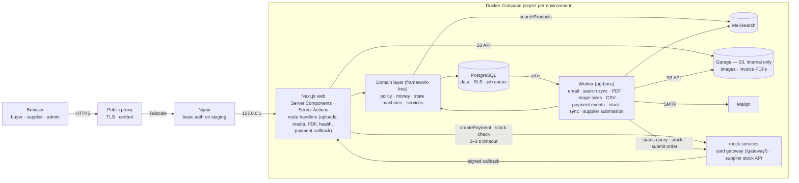
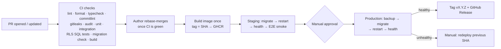

# HoReCa B2B Marketplace

> One place where hotels, restaurants and cafés buy equipment and supplies directly from manufacturers and distributors.
> AI-DEV 2026 practical phase · @BogdanD3 & @MarkoBojovich · DevelopersLab · Coinis

**Status:** 🚧 in development · **Production:** https://horeca.bogdandelic.online · **Staging:** https://staging.horeca.bogdandelic.online (basic auth) · **Repo:** github.com/horeca-ai-dev/horeca-marketplace · **Spec:** [`docs/specification/`](docs/specification/)

## What it does
Suppliers are companies **onboarded by the platform admin** (public registration is for **buyers only**). They list products manually or via CSV import with a validation report; **stock comes only from each supplier's API** (mocked) and is shown as a badge. Buyers — companies, not individuals — search one structured catalogue (category-specific attributes, filters, typo- and diacritics-tolerant search) and check out **once** for products from **several suppliers**, choosing a **purchase mode per supplier group**:

| Mode | When | Payment | Commission |
|---|---|---|---|
| **Direct** | Active contract with that supplier | Buyer and supplier invoice and pay each other outside the platform | Charged to the supplier per sub-order; the admin records its payment |
| **Platform (card)** | Always | Buyer pays the platform by card through a **mock gateway**; the platform issues the pro-forma and pays the supplier later | Kept from the payout (gross − commission) |
| **Request a contract** | No active contract | Not a purchase: the supplier accepts or rejects; an active contract enables direct mode | — |

The platform splits the checkout into **per-supplier sub-orders** with independent statuses and modes, computes the **platform commission**, records what each supplier is owed (or owes) in an **append-only ledger**, and issues **one pro-forma invoice PDF for the platform part** of an order. A platform admin creates suppliers, manages categories and commission, records supplier payouts and commission payments, and sees commission per supplier. The UI, e-mails and invoices are in **Montenegrin**.

**No real money flows.** Card payments go to a mock gateway with test cards only; money owed is recorded in an internal ledger. Decision record: [`docs/decisions/012-purchase-modes-payments-stock.md`](docs/decisions/012-purchase-modes-payments-stock.md).

### Feature checklist
**MVP**
- [ ] Organizations: buyer, supplier, platform admin · owner/member roles · one user in several organizations (org switcher)
- [ ] Buyer-only registration · admin "Create supplier" (set-password link) · tenant isolation (tested)
- [ ] Category tree with category-specific attributes · product CRUD · images
- [ ] Supplier CSV import with validation report
- [ ] Catalogue behind login · search (Meilisearch) + filters (category, price, supplier, attributes) · stock badge from the supplier API
- [ ] Multi-supplier cart with a purchase mode per supplier group · checkout · order splitting into sub-orders · sub-order lifecycle
- [ ] Contracts: request → accept / reject → end
- [ ] Card payment via a `PaymentProvider` + mock gateway (signed callbacks, expiry, refunds on cancellation)
- [ ] Sub-orders submitted to the supplier API (stock decremented, lines may be rejected)
- [ ] Commission in both modes · per-supplier ledger and balance · pro-forma invoice PDF (platform part) · admin overview
- [ ] Recording supplier payouts, adjustments and commission payments
- [ ] E-mail (Mailpit inbox): order, contract and payment notifications · password and set-password links
- [ ] Montenegrin UI, e-mails and invoice (`next-intl`)

**Stretch (after the MVP gate — the brief's stretch goals, in this order; see `TASKS.md`)**
Realistically 1–2 of them:
- [ ] S3 AI attribute normalisation
- [ ] S4 AI natural-language search
- [ ] S1 Volume pricing tiers · buyer-specific prices
- [ ] S5 Request for quote (RFQ)

*Only if time:* S2 product compare · S7 member invitations by e-mail · English UI

## Tech stack
| Layer | Choice | Why |
|---|---|---|
| Architecture | Next.js full-stack monolith (TypeScript), framework-free domain layer | One language and codebase both members can explain; shared types end to end |
| Database | PostgreSQL | Relational integrity for orders and ledger; JSONB attributes; `ltree`; RLS |
| ORM | Drizzle | SQL-shaped, type-safe; clean JSONB, locking and raw SQL |
| Search | Meilisearch behind `searchProducts()` | Typo and diacritics tolerance ("frizider" → "frižider") |
| Auth | Better Auth + organization plugin | Self-hosted; companies with members map onto organizations |
| Validation | Zod | One schema for forms, actions and CSV rows |
| i18n | next-intl | Montenegrin (Latin) UI, e-mails, invoice and error messages from day one |
| UI → server | Server Components (reads) + Server Actions via next-safe-action (writes) | No API layer to maintain; typed end to end |
| UI | shadcn/ui + Tailwind, TanStack Table, React Hook Form | Owned components, data-dense dashboards, fast forms |
| Jobs | pg-boss (queue inside PostgreSQL) | Jobs are enqueued in the same transaction as the data, so none are lost; no Redis to run |
| Files | S3-compatible object storage: self-hosted **Garage**, one per environment, behind one storage module (S3 API only) + sharp (decision 013) | Standard object storage from the start; product images in 3 WebP sizes served with `srcset` through our media route; invoice PDFs; no external account; moving to R2 / B2 / AWS S3 later = configuration only |
| PDF | Playwright HTML → PDF, in the worker | Print-quality invoices from React/Tailwind templates |
| E-mail | React Email templates · SMTP to Mailpit in every environment | The brief needs no real e-mail; demo e-mails are shown in the Mailpit inbox; a real provider = one env variable later |
| Tests | Vitest · Testcontainers · fast-check · Playwright · `psql` | Real Postgres/Meilisearch; RLS SQL tests; property tests for money; E2E on staging |
| Mocks | `mock-services` — card gateway + supplier stock API, the **fourth entry point** of the image (web, worker, migrate, mock-services) | Realistic payment and stock flows with no external accounts; behaviours (declined card, API down, out of stock) can be demoed |
| Ops | Docker Compose · GitHub Actions · GHCR · Tailscale · Nginx · pino | Build once, promote the same image |
| Versions | Node.js 26 LTS · PostgreSQL 16 · Next.js 16.4 · Meilisearch 1.56 · Garage 2.5 | Exact versions pinned; upgrades ≥ 2 weeks old except security releases |

## Architecture

The buyer reaches the gateway's hosted card page through the same proxies (`/gateway/` → `mock-services`). More diagrams: [`docs/diagrams/`](docs/diagrams/) (not yet updated for decision 012).

## ⚠️ Environment variables: build once, run anywhere

We build ONE Docker image per commit and promote that same image from staging to production. It is never rebuilt.

Next.js replaces every `process.env.NEXT_PUBLIC_*` reference with its literal value AT BUILD TIME. That value is frozen into the JavaScript bundle. Changing `/opt/horeca/production/.env` on the server does NOT change it.

Consequence: any environment-specific value in a `NEXT_PUBLIC_*` variable (API URL, app URL, Meilisearch key, bucket URL…) would ship with staging's value into production — silently.

### Rules
1. NO environment-specific values in `NEXT_PUBLIC_*`. Only values that are identical in every environment (e.g. app name) may use it.
2. All config is read at RUNTIME on the server via `src/env.ts` / `src/env.core.ts` (Zod-validated). Never read `process.env` directly elsewhere.
3. If the browser needs a config value, a Server Component passes it down as a prop, or a route handler returns it.
4. Secrets are server-only. `src/env.ts` imports `server-only`, so importing it from a Client Component fails the build. It re-exports `src/env.core.ts`, which has no `server-only` so that plain Node (worker, migrate, drizzle-kit, Vitest) can load it; ESLint keeps `src/app` and `src/components` on `src/env.ts`.

### Enforcement
- ESLint `no-restricted-properties`: bans `process.env` outside `src/env.core.ts`.
- ESLint/CI check: bans `NEXT_PUBLIC_` except an explicit allowlist.
- `assertEnv("web" | "worker" | "migrate")` validates every variable an entry point needs at startup (web: `src/instrumentation.ts`) — the container refuses to boot with a missing or malformed variable and lists all problems at once (names only, never values), so the health check fails before traffic is switched. `SKIP_ENV_VALIDATION=1` (Docker build stage) and `next build` skip it.

## Getting started
**Prerequisites:** Node.js 26 (`.nvmrc`), pnpm (the version pinned in `package.json` → `packageManager`), Docker + Docker Compose, Git.
```bash
git clone <repo-url> && cd horeca-marketplace
cp .env.example .env           # fill values; never commit .env
pnpm install                   # also installs Git hooks (Husky)
docker compose -f docker-compose.dev.yml up -d   # Postgres (+ init script with the 3 logins), Meilisearch, Mailpit, Garage
scripts/garage-setup.sh        # once: bucket + S3 key for .env — see "Local S3 (Garage)" below
pnpm db:migrate
pnpm db:seed
pnpm dev                       # http://localhost:3000
pnpm worker:dev                # second terminal
```
Local mail: Mailpit UI at `http://localhost:8025`. Local media files: the Garage bucket `horeca-media` (S3 API at `http://127.0.0.1:3900`). *(Until the storage module moves to S3 on D5-B3, the app still reads `MEDIA_DIR`.)*

**Database logins:** on first start, `deploy/postgres/init/01-roles.sh` creates `horeca_owner` (owns the `horeca` database, runs migrations), `horeca_app` and `horeca_worker` from the `POSTGRES_*_PASSWORD` values in `.env`. The script runs **only on an empty data volume**. If you change those passwords, or want a clean database, reset the volumes with `docker compose -f docker-compose.dev.yml down -v`, which deletes all local data. All ports are bound to `127.0.0.1`.

### Local S3 (Garage)
Media (product images, invoice PDFs) lives in S3-compatible object storage — a single-node **Garage** container ([decision 013](docs/decisions/013-s3-compatible-storage-garage.md)). The app talks to it only through the S3 API in `src/server/storage`; only the S3 port `127.0.0.1:3900` is published (RPC and admin API stay inside the Compose network).
1. In `.env`: `GARAGE_RPC_SECRET=$(openssl rand -hex 32)` (64 hex characters — Garage refuses to start otherwise) and any `GARAGE_ADMIN_TOKEN`.
2. `docker compose -f docker-compose.dev.yml up -d garage` — it shows **unhealthy until step 3** (no layout yet).
3. `scripts/garage-setup.sh` — applies the single-node layout, creates the bucket `horeca-media` and the key `horeca-app` with read/write on it, and prints `S3_ACCESS_KEY_ID` / `S3_SECRET_ACCESS_KEY` **once**: paste both into `.env`. Safe to run again (it skips what exists and never prints the secret again; to see it: `docker compose -f docker-compose.dev.yml exec garage /garage key info --show-secret horeca-app`).
4. Check: `docker compose -f docker-compose.dev.yml exec garage /garage health` → `HEALTHY`.

Config: `deploy/garage/garage.toml` (no secrets — Garage reads `GARAGE_RPC_SECRET` / `GARAGE_ADMIN_TOKEN` from the container environment). `docker compose … down -v` also deletes the bucket and its key — run the setup script again and update `.env`.

### Environment (`.env.example`)
| Variable | Purpose |
|---|---|
| `APP_URL` | Public base URL of this environment |
| `POSTGRES_PASSWORD` | The Postgres image's superuser — used only by the init script on an empty data directory |
| `POSTGRES_OWNER_PASSWORD`, `POSTGRES_APP_PASSWORD`, `POSTGRES_WORKER_PASSWORD` | Used by the Postgres init script to create the three logins |
| `DATABASE_URL` | App login `horeca_app` (web, and worker jobs acting for a user) — not owner, so RLS applies |
| `DATABASE_WORKER_URL` | Worker login `horeca_worker` — **worker container only**; system context for jobs acting for no user |
| `DATABASE_MIGRATE_URL` | Owner login `horeca_owner` — migrate container only |
| `MEILI_HOST`, `MEILI_API_KEY` | Meilisearch (server-side only, never sent to the browser) |
| `BETTER_AUTH_SECRET`, `BETTER_AUTH_URL` | Better Auth |
| `S3_ENDPOINT`, `S3_REGION`, `S3_BUCKET`, `S3_FORCE_PATH_STYLE` | Media storage (product images, invoice PDFs) via the S3 API — Garage locally (`http://127.0.0.1:3900`, region `garage`, bucket `horeca-media`, path-style `true`); on the server the internal Garage service |
| `S3_ACCESS_KEY_ID`, `S3_SECRET_ACCESS_KEY` | The app's key (read/write on that one bucket only), printed once by `scripts/garage-setup.sh` |
| `GARAGE_RPC_SECRET`, `GARAGE_ADMIN_TOKEN` | Garage's own secrets, read by the Garage container only (RPC secret: `openssl rand -hex 32`) |
| `MEDIA_DIR` | **Being removed** (decision 013): still required by `src/env.core.ts` until the storage module moves to S3 (D5-B3) |
| `EMAIL_FROM`, `SMTP_URL` | SMTP to Mailpit in every environment |
| `REGISTRATION_OPEN` | `true` / `false` — close registration on production if needed |
| `SEED_DEMO_PASSWORD` | Password for seeded demo accounts; required on production (never the README password) |
| `PAYMENT_GATEWAY_URL` | Base URL of the mock gateway (`mock-services`) as seen from web and worker |
| `PAYMENT_GATEWAY_API_KEY` | API key our app sends to the gateway |
| `PAYMENT_WEBHOOK_SECRET` | HMAC-SHA256 secret for verifying payment callbacks (shared with `mock-services`; different per environment) |
| `SUPPLIER_API_URL` | Base URL of the supplier stock API (`mock-services`; the supplier ID is in the path) as seen from web and worker |
| `SUPPLIER_API_KEY` | API key our app sends to the supplier stock API |
| `AI_ENABLED` | `false` by default; `true` only for testing and the demo (stretch S3/S4) |
| `APP_ENV` | `local` / `staging` / `production` — staging banner (runtime, never `NEXT_PUBLIC_*`) |
| `LOG_LEVEL` | pino log level (`fatal` … `trace`). Logs are JSON lines on stdout in every environment — in `src/server/logger.ts` use `getLogger("component")` and log errors as `{ err }` (secrets are redacted, query parameter values never appear). Readable locally: `… \| pnpm dlx pino-pretty` |
| `ANTHROPIC_API_KEY`, `ANTHROPIC_MODEL` | AI features (stretch), server-side only |

### Demo accounts (seed data — local and staging; on production the password comes from `SEED_DEMO_PASSWORD`)
`pnpm db:seed` (on a server: `node dist/seed.mjs` from the same image) creates the category tree and attribute definitions, then the accounts below. Users are created through Better Auth's server API (so it works with `REGISTRATION_OPEN=false`), organizations and profiles as `horeca_owner`. It only adds what is missing, so it is safe to run again and never resets a password. **On production it refuses** to run without `SEED_DEMO_PASSWORD`, or with the README password, or with fewer than 12 characters. All company names, tax IDs and IBANs are fictional. Supplier C has a 650 bps commission override (A and B use the platform default).

| Account | E-mail | Password |
|---|---|---|
| Platform admin | `admin@demo.local` | `Demo-1234!` |
| Supplier A / B / C (owners; created by the seed — suppliers cannot self-register) | `supplier-a@demo.local` … `supplier-c@demo.local` | `Demo-1234!` |
| Buyer: hotel / café | `buyer-hotel@demo.local`, `buyer-cafe@demo.local` | `Demo-1234!` |
| One company, two organizations (buyer + supplier) | `multi@demo.local` | `Demo-1234!` |

## Scripts
`pnpm dev` · `pnpm worker:dev` · `pnpm build` · `pnpm build:entries` (bundles worker, migrate and seed into `dist/`) · `pnpm start` · `pnpm lint` · `pnpm typecheck` (`next typegen` + `tsc --noEmit`) · `pnpm format` · `pnpm format:check` · `pnpm test` · `pnpm test:integration` · `pnpm test:rls` (RLS tests with psql on a throwaway database; needs the Compose Postgres) · `pnpm test:e2e` · `pnpm db:generate` · `pnpm db:migrate` · `pnpm db:seed` · `pnpm db:reset` · `pnpm search:reindex` · `scripts/smoke-g0.sh` (G0 smoke test; env `SMOKE_BASE_URL`, `SMOKE_BASIC_AUTH_USER`/`_PASS`)

## Project structure
```
src/
  app/              # (public)/ auth pages, buyer/, supplier/, admin/ route areas; api/ (only the listed route handlers)
  components/       # ui/ (shadcn primitives), domain/ (ProductCard, FilterSidebar, MoneyText…)
  server/
    domain/         # services, policy, money, state machines — framework-free
    db/             # Drizzle schema, migrations, withTx(), scoped query helpers
    jobs/           # pg-boss queues and processors
    search/         # Meilisearch client + searchProducts()
    email/          # sendEmail() adapter (SMTP) + React Email templates
    storage/        # put / get / delete / head / list via the S3 API (Garage)
  lib/              # shared Zod schemas, formatting
  env.core.ts       # runtime config (Zod, assertEnv) — the only reader of process.env
  env.ts            # server-only re-export for Next.js code
  instrumentation.ts # web startup: assertEnv("web")
  worker.ts         # worker entry point
deploy/             # compose.yml (one file, per-env .env), deploy.sh, backup.sh, Nginx site examples, postgres/init/
docs/               # specification/, decisions-9-11/ (schema drafts, matrix, money rules, RLS tests), decisions/ (ADRs), diagrams/
tests/              # unit/, integration/, e2e/
```

## Testing
- **Unit / property (Vitest + fast-check):** money, order splitting, commission, state machines, CSV row validation, policy.
- **Integration (Testcontainers):** real Postgres (a fresh container per run: the same init script, then the migrate entry — see `tests/integration/global-setup.ts`; Meilisearch joins with D7)  — transactions and rollback, RLS (the SQL tests from `docs/decisions-9-11/tests/`, run with `psql`, edited only as `APPLIED.md` lists), authorization matrix (supplier A vs B, buyer A vs B, every role), search visibility, checkout locking.
- **Money:** `money-vectors.json` worked examples as unit-test vectors + fast-check invariants.
- **E2E (Playwright):** smoke test after every staging deploy; full Definition-of-Done suite before each gate.

## Git workflow
- `main` is protected: no direct pushes, no force-pushes; PR required with green checks and linear history. **Required approvals: 0** — the author merges once CI is green.
- Reviews (≈ 1h per person per day): a **light daily read of the other member's merged PRs** ("do I understand what this does and why?"), a Claude Code review when wanted, and the daily explain-back (`docs/explain-back.md`).
- Branches: `type/issue-short-description` (e.g. `feat/14-csv-import`). Types: `feat`, `fix`, `refactor`, `test`, `docs`, `chore`, `ci`, `infra`.
- Commits: **Conventional Commits** (`feat(catalogue): validate CSV rows against attribute schema`).
- Merge: **rebase-and-merge** (keeps both members' commits). Clean up WIP commits before merging. Use `Co-authored-by:` when helping on the other's branch.
- PRs: **one per feature slice** (2–3 per person per day), aim < 400 changed lines, link the tasks (`Closes #14`), fill in the template checklist. Branches need not be up to date with `main` before merging.
- Migration conflict after rebase: delete your generated migration, regenerate, commit.

### Toolset
| Tool | Purpose | Runs |
|---|---|---|
| GitHub branch ruleset on `main` | PR + green checks + linear history (0 required approvals — author merges); no direct/force push; "up to date" not required | GitHub |
| Husky | Installs Git hooks for both members | Local |
| lint-staged | `pre-commit`: ESLint + Prettier on staged files | Local |
| commitlint (`@commitlint/config-conventional`) | `commit-msg`: Conventional Commits | Local + CI |
| `pre-push` hook | `tsc --noEmit` | Local |
| ESLint (`eslint-config-next`, import boundaries, `process.env`/`NEXT_PUBLIC_` bans) | Code quality and architecture rules | Local + CI |
| Prettier (+ `prettier-plugin-tailwindcss`) | Formatting | Local + CI |
| `.github/pull_request_template.md` | PR checklist | GitHub |
| gitleaks | Secret scanning | CI |
| GitHub Issues + Projects | Tasks linked to branches and PRs | GitHub |

Local hooks can be skipped; CI re-runs every check and is what protects `main`.

### PR checklist (template)
- What and why · how to test · screenshots for UI changes
- Tests added/updated for changed logic
- Authorization considered (who can call this, scoped to the actor's organization?)
- Migration tested locally on a copy of the seed data
- No secrets or `.env` values
- Spec/README updated if a decision changed
- I can explain every line, including code generated by Claude

## CI/CD

- **PR checks** run in parallel on GitHub runners (target < 10 min); a new push cancels the stale run. *Migration check* = `drizzle-kit check` + applying all migrations to an empty database; *RLS SQL tests* = `rls_tests.sql` via `psql`.
- **Image:** multi-stage `Dockerfile`, Next.js `output: 'standalone'`, one image with four entry points (mock-services arrives with D6-A3). It runs as the non-root `node` user; the build needs no runtime variables (`SKIP_ENV_VALIDATION=1` in the build stage).

  | Entry | Command | Notes |
  |---|---|---|
  | web | `node web/server.js` (default) | listens on `:3000`; needs the web variables (`assertEnv("web")`) |
  | worker | `node dist/worker.mjs` | needs `DATABASE_WORKER_URL`, `SMTP_URL`, …; Chromium headless shell for PDFs |
  | migrate | `node dist/migrate.mjs` | one-shot, `DATABASE_MIGRATE_URL` only; exits non-zero on failure |

  No media volume: media lives in the environment's Garage, reached over the S3 API (decision 013). The image still sets `MEDIA_DIR=/data/media` until D5-B3 removes it from `src/env.core.ts`. The image has no `curl`: a Compose healthcheck uses `node -e "fetch('http://127.0.0.1:3000/api/health').then(r => process.exit(r.ok ? 0 : 1), () => process.exit(1))"`. Run containers with `init: true` so signals reach Node.
  `--build-arg INSTALL_CHROMIUM=0` skips the Chromium download (fonts stay) for local builds on a network that blocks `storage.googleapis.com` — that image cannot render PDFs; CI and the release image always use the default `1`.
- **Migrations** run as a one-off `migrate` container using Drizzle's runtime migrator.
- **Deploy** over SSH as the dedicated `deploy` user running `deploy.sh <env> <sha>`. The server is reachable only through Tailscale, so the deploy job first joins the tailnet with the official **Tailscale GitHub Action** (`tailscale/github-action@v4`) using **Tailscale federated identity (workload identity federation)** — no long-lived Tailscale secret. The workflow sets `permissions: id-token: write` and passes `oauth-client-id`, `audience` and `tags: tag:ci`. The federated credential trusts only GitHub jobs whose subject matches `repo:horeca-ai-dev@360824986/horeca-marketplace@1470667672:environment:*` (the deploy jobs in the `staging` / `production` Environments). The tailnet grant allows `tag:ci` only `tcp:22` on the server's Tailscale IP. GitHub stores the SSH key (secret) and `TS_OAUTH_CLIENT_ID` + `TS_AUDIENCE` (identifiers, not sensitive) per Environment.
- **E2E on staging:** a smoke test after every deploy; the full suite before each gate. Playwright runs from GitHub against the staging URL; basic-auth credentials are a GitHub Environment secret; tests create unique data per run.
- **Dependabot:** security updates only.

## Deployment & releases

### Flow
- `main` is the only long-lived branch. There are no staging/prod branches.
- Every merge to `main` builds one Docker image (tagged with the commit SHA) and deploys it to **staging** automatically.
- **Production** deploys the same image after manual approval. Required reviewers: both team members.

### Approving a production deploy
1. Actions → open the workflow run → **Review deployments**.
2. Select `production` → **Approve and deploy**.
3. Only one approval request is pending at a time (concurrency group `production`). A newer merge replaces the older request, so approving ships everything merged since the last production deploy.

### Releases & versioning
- After a production deploy passes its health check, CI automatically:
  - calculates the next version from Conventional Commits since the last tag (`fix:` → patch, `feat:` → minor),
  - creates the Git tag `vX.Y.Z` and a GitHub Release with generated notes,
  - tags the Docker image with the same version.
- A tag exists only for versions that actually ran in production. Failed or rolled-back deploys are never tagged.
- During development versions are `0.x.y`; `v1.0.0` is cut manually for the final demo.

### Fixing problems
- CI fails on a PR → push fixes to the same branch; the PR updates.
- Bug found on staging or production → new branch → PR → merge → verify on staging → approve to production.
- Nothing reaches production without passing staging.

### Rollback (manual)
- Every production deploy takes a `pg_dump` first.
- If production is broken after a deploy: re-run the deploy with the previous SHA or release tag (one click); if a migration broke data, restore the pre-deploy dump.
- The health check gates deploys on Postgres + migration version only; Meilisearch, Mailpit and the worker are reported as degraded, not blocking.

### Deploy files (staging since D3; production half = D5-A1)
| File | Installed on the server as | What it does |
|---|---|---|
| `.github/workflows/deploy.yml` | — | push to `main` → build + push `ghcr.io/horeca-ai-dev/horeca-marketplace:<sha>` → join the tailnet → `ssh deploy@… "staging <sha>"` → `scripts/smoke-g0.sh` |
| `deploy/deploy.sh` | `/opt/horeca/bin/deploy.sh` (root, 755) | the forced command of the deploy key: `staging <sha>` = pull → Postgres up (waits) → Meilisearch, Mailpit, Garage up (never waited for) → migrate (one-off) → `up` web + worker → wait ≤ 90 s for `/api/health` 200 → prune images (keep 5 SHAs); `staging-reset <sha>` = the same after `down --volumes` (**deletes all staging data**, Garage's bucket and key included — run the Garage setup again afterwards, see below; the Postgres init script runs only on an empty volume, so this is also how changed DB passwords take effect; no seed entry yet → staging starts empty); `production …` → "not enabled yet". Log: `/opt/horeca/<env>/deploy.log`; current SHA: `/opt/horeca/<env>/deployed-sha` |
| `deploy/compose.yml` + `deploy/postgres/init/` + `deploy/garage/garage.toml` | `/opt/horeca/deploy/` (same relative paths) | one Compose file for both environments; project `horeca-<APP_ENV>` (`horeca-staging` / `horeca-production`); values from `/opt/horeca/<env>/.env`. Services: web, worker, Postgres, Meilisearch, Mailpit, Garage (`dxflrs/garage:v2.5.0`, no ports, 128m, volumes `garage-meta` / `garage-data`); one-offs `migrate` (profile `migrate`) and `media-backup` (`rclone/rclone:1.75.2`, profile `backup`) |
| `scripts/garage-setup.sh` | `/opt/horeca/bin/garage-setup.sh` (root, 755) | once per environment (and after every `staging-reset`): Garage layout, bucket `horeca-media`, app key with read/write on it — prints `S3_ACCESS_KEY_ID` / `S3_SECRET_ACCESS_KEY` **once**; safe to repeat |
| `deploy/env.staging.example` | template for `/opt/horeca/staging/.env` (deploy, 600) | every key; hosts are the Compose service names |
| `deploy/nginx/horeca-upgrade-map.conf.example` | `/etc/nginx/conf.d/horeca-upgrade-map.conf` | WebSocket `map` for `/_mail/`, shared by both sites |
| `deploy/nginx/horeca-staging.conf.example` | `/etc/nginx/sites-available/horeca-staging` | `listen <SERVER_TAILSCALE_IP>:8081` — the Tailscale address only (shared with production, told apart by `server_name`) → `127.0.0.1:3101`, basic auth, plus the **only** `default_server` on that address:port (unknown Host → 444; the production site uses a plain `listen <SERVER_TAILSCALE_IP>:8081;`), real IP from the friend's proxy, `/_mail/` → Mailpit |
| `deploy/backup.sh` + `deploy/cron.example` | `/opt/horeca/bin/backup.sh`, `/etc/cron.d/horeca-backup` | nightly `pg_dump` → `/var/backups/horeca/<env>/nightly/` (keep 7) + `rclone copy` of the bucket → `/var/backups/horeca/<env>/media/` (production cron line enabled with D5-A1) |
| `scripts/smoke-g0.sh` | — | G0 smoke test (bash + curl): health, sign-up, sign-in, `/g0-check`, its Server Action (same Origin → `UNAUTHENTICATED` envelope; foreign Origin → refused), wrong password → 401; prints the manual two-network rate-limit check |

**⚠️ Drift:** the server does not pull deploy files from Git. When `deploy/compose.yml`, `deploy/postgres/init/`, `deploy/garage/garage.toml`, `deploy.sh`, `backup.sh`, `scripts/garage-setup.sh` or an Nginx example changes, copy it to the server by hand in the same session as the merge (the next deploy uses whatever is on the server).

**Memory:** our project gets ≈ 4 GB for staging + production together. Staging defaults (override in `.env`): web 384m, worker 768m, Postgres 384m, Meilisearch 256m, Mailpit 64m, Garage 128m, migrate 256m, media-backup 128m (≈ 2 GB running). **Stop staging when not testing** (`docker compose -p horeca-staging stop`, as `deploy`); production stays up.

**Not covered by G0:** the Server Action running as `horeca_app` with the RLS context set — the smoke user has no organization (only our registration creates one; form D4-A3). Proven by the D4/D5 RLS tests.

**Meilisearch:** for now the app uses the master key (`MEILI_API_KEY` = `MEILI_MASTER_KEY`). TODO when search lands: a scoped key.

### GitHub setup (once)
Environment **`staging`** (Settings → Environments; deployment branches: `main` only) with these secrets:

| Secret | Value |
|---|---|
| `TS_OAUTH_CLIENT_ID`, `TS_AUDIENCE` | from the Tailscale federated-identity credential (identifiers, not sensitive) |
| `DEPLOY_HOST` | the server's Tailscale IP or MagicDNS name (never in the repo) |
| `DEPLOY_SSH_KEY` | private half of the deploy key (ed25519, no passphrase) |
| `DEPLOY_KNOWN_HOSTS` | the server's host-key line for `DEPLOY_HOST` (`ssh-keyscan`, fingerprint checked on the server) |
| `STAGING_BASIC_AUTH_USER`, `STAGING_BASIC_AUTH_PASS` | the staging Nginx basic-auth login (used by the smoke test) |

GHCR: the image package `horeca-marketplace` is **public** (the server pulls without a login). Production Environment + secrets: D5-A1.

### One-time server setup (staging)
Done already: user `deploy` (docker group), `/opt/horeca/{staging,production,bin}`, `/var/backups/horeca`. Then, as an admin user:
1. Packages: `apt install curl apache2-utils` (curl for `deploy.sh`'s health wait, `htpasswd`).
2. Deploy files: copy `deploy/compose.yml` → `/opt/horeca/deploy/compose.yml`, `deploy/postgres/init/01-roles.sh` → `/opt/horeca/deploy/postgres/init/` (world-readable: the Postgres container reads it), `deploy.sh` + `backup.sh` → `/opt/horeca/bin/` (root:root, 755).
3. Secrets: `/opt/horeca/staging/.env` from `deploy/env.staging.example` with generated values (`chown deploy: … && chmod 600`); `/opt/horeca/staging` owned by `deploy` (lock, log, `deployed-sha`).
4. Deploy key: `ssh-keygen -t ed25519 -N '' -C horeca-ci-deploy -f horeca-deploy` (on a laptop); append to `~deploy/.ssh/authorized_keys`: `command="/opt/horeca/bin/deploy.sh",restrict ssh-ed25519 AAAA… horeca-ci-deploy`.
5. Nginx: map → `conf.d`, site → `sites-available` (fill in the two Tailscale IPs) + symlink in `sites-enabled`; `htpasswd -c -B /etc/nginx/htpasswd/horeca-staging <user>` (root:www-data, 640). Because the site listens on the Tailscale address only, Nginx must be able to start before `tailscaled` is up at boot: `net.ipv4.ip_nonlocal_bind = 1` in `/etc/sysctl.d/` (then `sysctl --system`). `nginx -t && systemctl reload nginx`; `ss -ltnp | grep 8081` must show only the Tailscale address.
6. Backups: `/var/backups/horeca` owned by `deploy`; `deploy/cron.example` → `/etc/cron.d/horeca-backup` (production line stays commented until D5-A1).
7. Garage (D5-A5, decision 013; per environment — production the same with `production` paths):
   1. `.env`: add `GARAGE_RPC_SECRET` (`openssl rand -hex 32`), `GARAGE_ADMIN_TOKEN` (any random string), the `S3_*` keys from `deploy/env.staging.example` with the **placeholder** key pair (Compose needs every key set, even to start Garage). Do this **before** copying the new `compose.yml`, or every `docker compose` call on it fails.
   2. Copy `deploy/garage/garage.toml` → `/opt/horeca/deploy/garage/garage.toml` (world-readable) and `scripts/garage-setup.sh` → `/opt/horeca/bin/` (root:root, 755).
   3. Start Garage (it stays **unhealthy** until the next step), then run the setup:
      ```
      sudo env COMPOSE_FILE=/opt/horeca/deploy/compose.yml COMPOSE_PROJECT_NAME=horeca-staging \
        ENV_FILE=/opt/horeca/staging/.env IMAGE_TAG="$(cat /opt/horeca/staging/deployed-sha)" \
        /opt/horeca/bin/garage-setup.sh
      ```
      It prints `S3_ACCESS_KEY_ID` / `S3_SECRET_ACCESS_KEY` once → replace the placeholders in `.env`, then redeploy (or `up -d --force-recreate web worker`) so web and worker get the real key.
   4. After `staging-reset` (which deletes Garage's volumes) repeat 3 — the key pair is new.
   5. The old `horeca-<env>_media` volume is no longer used; remove it with `docker volume rm` once you have checked it is empty.

## Server & infrastructure
| Environment | Where | Data |
|---|---|---|
| Local | Developer machines; services in Docker, app via `pnpm dev` | Seed |
| CI | GitHub runners, Testcontainers | Throw-away |
| Staging | Server, Compose project `horeca-staging`, behind basic auth | Seed, resettable (`deploy.sh staging-reset <sha>`) |
| Production | Server, Compose project `horeca-production` | Real |

- **Isolation:** staging and production have separate Compose projects, networks, volumes, `.env` files and Garage instances (each with its own bucket and key), plus `mem_limit` on every container. Each runs web, worker, mock-services, Postgres (with the job queue), Meilisearch, Garage and Mailpit.
- **Media storage (decision 013; on the server from D5):** one single-node Garage container per environment (≈ 128m, volumes for data + metadata), **internal only** — no `ports:` entry, nothing for the public proxy, Tailscale or Nginx; web and worker reach it by service name over the S3 API, and images / PDFs reach browsers only through our media and download route handlers (login required, `Cache-Control: private`). Set up once per environment with `scripts/garage-setup.sh`. Our Nginx routes `/gateway/` to `mock-services`; the gateway's admin page is behind basic auth in every environment. The Mailpit UI is served by our Nginx at `/_mail/` behind basic auth (shown on screen in the demo — no SSH tunnel needed).
- **Domains & traffic:** `horeca.bogdandelic.online` (production) and `staging.horeca.bogdandelic.online` — A records at Namecheap pointing to the friend's public server, which terminates TLS (certbot) and forwards over **Tailscale** to our server (`proxy_pass http://<SERVER_TAILSCALE_IP>:8081` for both domains). It must pass `X-Forwarded-For`, `X-Forwarded-Proto: https` and the host, allow ≈ 20 MB uploads and slightly longer timeouts.
- **Our Nginx (on the server, listening on the Tailscale address only, port `8081`):** one site per environment on the same address:port, told apart by `server_name` → `127.0.0.1:3102` (prod) / `127.0.0.1:3101` (staging) — host ports 3000/3001 are taken on the server; `auth_basic` on staging; `set_real_ip_from` = friend's Tailscale IP; `X-Forwarded-Proto` passed through unchanged; `client_max_body_size` ≈ 20 MB.
- **⚠️ Ports:** every `ports:` entry starts with `127.0.0.1:` (e.g. `127.0.0.1:3102:3000` prod, `127.0.0.1:3101:3000` staging; Mailpit UI `127.0.0.1:8127` / `127.0.0.1:8126` — set by `WEB_PORT` / `MAILPIT_UI_PORT` in each `.env`). The short form `"3000:3000"` binds to all interfaces, and Docker's iptables rules are evaluated **before ufw** — the port becomes public even though ufw "blocks" it. Postgres and Meilisearch have **no** `ports:` entry on the server.
- **Hardening:** the server has **no public IP** — it is reachable only from its local network and through Tailscale — and **no active host firewall**. So nothing relies on a firewall: every HoReCa port is bound explicitly, containers to `127.0.0.1` and our Nginx to the Tailscale address (`<SERVER_TAILSCALE_IP>:8081`); Postgres and Meilisearch publish no port at all. SSH keys only, no root or password login; automatic OS security updates; the `deploy` user only runs `deploy.sh`.
- **Other services on the server** (it is shared) are outside this project: their ports, exposure and updates are not managed or covered here.
- **Health:** Docker healthchecks; `/api/health` = Postgres + migration version (gates deploys); Meilisearch, Garage, Mailpit and the worker reported as degraded (worker: oldest waiting pg-boss job older than 5 min).
- **Backups:** nightly `pg_dump` of production plus one before every production deploy, and a nightly **object-level copy of the production bucket through the S3 API** (`rclone copy` in the one-off `media-backup` container, `rclone/rclone:1.75.2`, configured only through environment variables → `/var/backups/horeca/production/media/`; restore = copy back through the S3 API), stored on the server; keep 7 nightly + 5 pre-deploy dumps. The media copy uses **`copy`, not `sync`**: an object deleted from the bucket (by a bug or by mistake) stays in the backup — the trade-off is that the backup only grows and keeps objects the app deleted on purpose, which is fine at our size (a few hundred images and PDFs). A restore of a pre-deploy dump into a scratch container is tested once (D5); restored waiting jobs run again, which is harmless with Mailpit. Meilisearch is rebuilt with `pnpm search:reindex`; staging is not backed up.
- **Database logins:** three roles per environment, created by the Postgres init script — `horeca_owner` (non-superuser owner, migrations), `horeca_app` (web), `horeca_worker` (worker); passwords in the server's `.env` files, never in Git.
- **Secrets:** runtime secrets in `/opt/horeca/staging/.env` / `/opt/horeca/production/.env` on the server (mode `600`, owned by `deploy`); CI secrets (SSH key, GHCR token if the image package is private) in GitHub Environments, next to the non-sensitive Tailscale federated-identity values `TS_OAUTH_CLIENT_ID` and `TS_AUDIENCE` (there is no Tailscale client secret).
- **Monitoring:** pino JSON logs with Docker log rotation; `/api/health`. (Sentry, an uptime monitor and an admin Jobs page are on the "after the project" list.)
- **Images:** `deploy.sh` prunes old images, keeping the last five SHAs.
- **E-mail:** SMTP to Mailpit in every environment — demo e-mails never leave the server; no provider, no SPF/DKIM.

## Key design decisions (rejected alternatives in brackets)
- Next.js full-stack monolith with framework-free domain layer *(Django — admin for free, but two languages and incompatible tooling; Next.js + NestJS — extra boilerplate)*
- Drizzle *(Prisma — weak for JSONB and full-text queries)*
- Meilisearch behind `searchProducts()` *(Postgres FTS + trigram — weaker typo tolerance)*
- Better Auth with organizations *(Auth.js — no organizations; Clerk — external user data)*
- Server Actions + Server Components *(REST route handlers, tRPC — extra layer)*
- pg-boss, jobs enqueued in the same transaction *(Redis + BullMQ — a job could be lost if Redis is down at checkout; 2–4 extra containers; caching not needed for a demo catalogue)*
- Playwright HTML → PDF in the worker *(react-pdf, WeasyPrint)*
- Separate buyer and supplier organizations per company, one login *(one organization with buy/sell capabilities — doubles the permission matrix)*
- Platform admin as an organization type *(user-level admin flag)*
- Trunk-based with rebase-merge *(GitFlow; squash merge — loses per-member commits)*
- Approval-gated production deploys + automatic release tags *(tag-triggered deploys)*
- SSH deploy *(self-hosted GitHub runner)*
- On-server backups only *(off-server copy — accepted risk)*
- Public repo in a free GitHub organization *(private repo — needs a paid plan for rulesets and environment approvals; self-hosted Gitea — mentors could not see it, CI would run on the production server, no approval gate)*
- Deploy through Tailscale's GitHub Action *(self-hosted runner; server pulling new versions — breaks the approval and rollback flow)*
- Media in S3-compatible object storage — self-hosted Garage per environment, internal only, uploads and downloads through the app, 3 WebP sizes with `srcset` (decision 013, replaces decision J) *(Docker volume — not object storage, harder to move; MinIO — archived in April 2026; a cloud bucket now — external account and card, possible later by configuration only; presigned direct browser uploads now — need a public storage endpoint and CORS, not needed for the demo)*
- Mailpit for all e-mail *(Resend — the brief needs no real e-mail; seeded addresses cannot receive mail)*
- Manual rollback with a pre-deploy dump *(automatic rollback — requires every migration to be backward-compatible)*
- Normal invoice number sequence *(gapless numbering — a pro-forma has no legal numbering requirement; it serialises all checkouts)*
- Three purchase modes chosen **per supplier group** — direct under a contract, platform by card, request a contract (decision 012) *(mode per whole order — forces buyers to split carts; buyers pay the platform only — mentors decided against it)*
- Keep `order_payments` + `app.recompute_order()`; the worker inserts receipts / refunds from gateway events *(dropping them — throws away tested logic; manual "record buyer payment" screen — receipts now come from the gateway)*
- Payment callbacks verified and enqueued by the web, processed by the worker *(processing in the web container — no actor context there)*
- One `mock-services` app for gateway + stock API, fourth entry point of the image *(two separate mock services — 3–4 h more infrastructure)*
- Gateway depth in steps: success / declined / forged / replayed before G3, 3-D Secure and other cards after *(full depth before G3 — time)*
- Suppliers onboarded by the admin; buyer-only registration *(self-registration + approval queue — the mentors want a list of collaborating companies, added by the admin)*
- Stock only from the supplier API, cached every 5 min *(stock in CSV — mentors' decision: CSV is for product data only)*
- One pro-forma per order for the **platform part**, issued by the platform *(one per sub-order — buyer pays several times; including direct sub-orders — the platform does not invoice those)*
- Half-up rounding, VAT per line, commission once per sub-order on net, rates in basis points *(half-even; VAT on totals; commission per line)*
- Supplier-owned listings + optional GTIN *(shared master catalogue with offers)*
- Typed attribute definitions inherited down an `ltree` tree, values in JSONB *(EAV; table per category)*
- RLS as second layer with three database roles *(one app role with a "system mode" switch)*

Full ADRs: [`docs/decisions/`](docs/decisions/).

## Known limitations *(keep honest; update before the demo)*
- No real payments, payouts or licensing; **holding third-party funds is a regulated activity** and needs legal review before any real launch.
- No fiscalization (Montenegrin Tax Administration); VAT rates and PIB rules are configuration and must be verified before real use.
- Single currency (EUR); Montenegrin UI only (English only if time allows).
- VAT on the platform commission is not modelled.
- The card gateway and the supplier APIs are **mocks** (test cards only; in-memory state reset on restart). 3-D Secure and the extra failure cards arrive after G3.
- Stock is cached every 5 minutes; a badge may be up to 5 minutes old (the checkout re-checks it).
- Refunds happen only by cancelling a paid platform sub-order before shipping; there is no separate admin refund action.
- Direct-mode commission is netted against platform payouts and charged at order placement — **to confirm with the mentors**.
- A new supplier's set-password link stays in Mailpit; the admin hands it over.
- Product data is scraped from two real Montenegrin suppliers into a private, uncommitted seed; **production uses fictional supplier names and closed registration** unless the companies agree.
- Buyer-specific prices (S1) are not filterable or sortable in search (the index holds the base price).
- Buyers cannot be suspended; only suppliers.
- E-mails go only to the Mailpit inbox (no real delivery).
- Product photos in the generated seed are dummy images.
- The pro-forma covers only the platform part; direct sub-orders are invoiced by the supplier outside the platform. After a cancellation the stored PDF keeps the original total; the order page shows the amount due.
- The public proxy (friend's server) terminates HTTPS and could see traffic; fine for a demo with fake data, not for real customers. If that server is down, the site is down.
- Media files (images, PDFs) live in a single-node Garage on the same server (replication factor 1) — no redundancy beyond the nightly S3 copy; moving them to an external S3 provider is a configuration change plus one `rclone sync` (decision 013).
- Backups are stored on the same server — a disk failure loses data and backups together.
- Staging and production share one server — a server outage takes down both.
- *(Add every stretch feature not finished by the feature freeze.)*

## Working with Claude
Rules are in [`CLAUDE.md`](CLAUDE.md): spec first, every change through a PR with green CI, never paste secrets, both members must explain all code.

## Team
| Member | Focus |
|---|---|
| @BogdanD3 | Infrastructure, CI/CD, database operations, frontend |
| @MarkoBojovich | Domain layer, database schema & migrations, background jobs, seed data, E2E test suites |

## License
Educational project — add a licence if you publish the repository.
